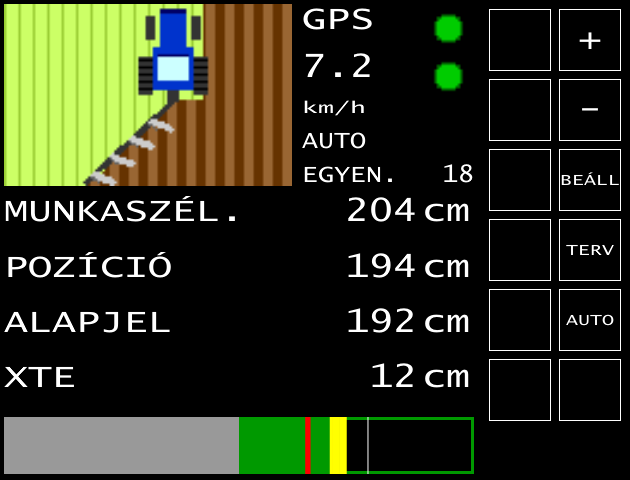
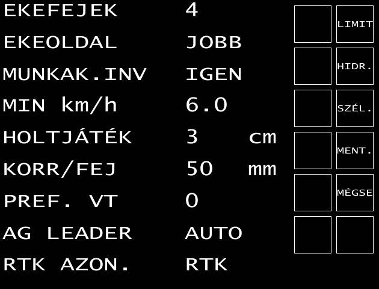
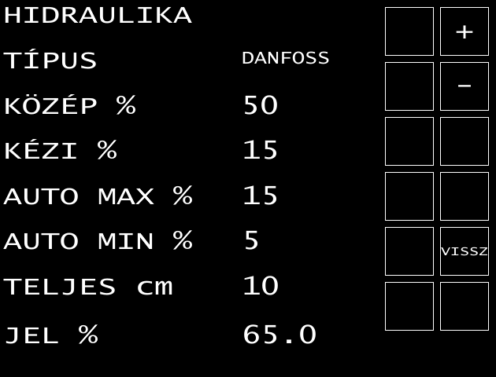
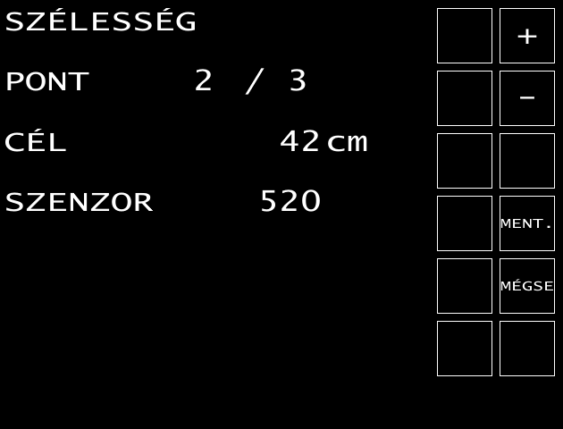
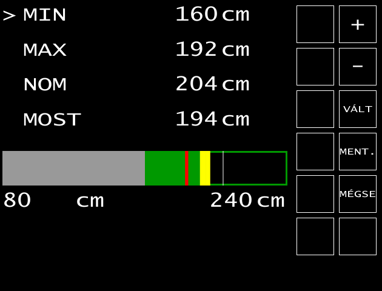
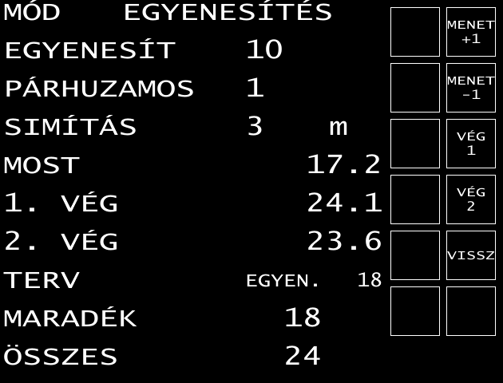

# Ekevezérlés ISOBUS – használati útmutató

Az útmutató a VT-n (ISOBUS terminálon) kezelt ekevezérlést írja le, az AgOpenShop ESP32 rate boardos változatot. A képek a 2026-11-17-i firmware-ből készültek (pool MW28). A képeken látható értékek csak példák.

Tartalom:
1. [Mi hol van](#1-mi-hol-van)
2. [Felszerelés után: alapbeállítás](#2-felszerelés-után-alapbeállítás)
3. [A szélességérzékelő kalibrálása](#3-a-szélességérzékelő-kalibrálása)
4. [A fizikai határok (LIMIT) beállítása](#4-a-fizikai-határok-limit-beállítása)
5. [Szántás](#5-szántás)
6. [Hibakeresés](#6-hibakeresés)

---

## 1. Mi hol van

### 1.1 Főképernyő

**Bal felső sarok:**

| Elem | Jelentés |
|---|---|
| Kép | Az eke és az ekeoldal: merre fordít az eke. |
| GPS ● | Zöld: friss GPS-adat jön. Az AgOpenGPS-es (`AOG_TC_GUIDANCE`) buildben ehhez friss sebesség és XTE kell; a többi buildben pozíció és az RTK AZON. szerinti minőség is. Piros: valami hiányzik. |
| km/h ● | A sebesség. Zöld, ha eléri a MIN km/h-t, egyébként piros. |
| Állapot | **AUTO**: szabályoz. **KÉZI**: kézi mód. **GPS HIBA** / **SEB. HIBA**: automatában vár, mert nincs jó GPS, vagy túl lassú. **KALIB.**: a beállítások nyitva vannak. |
| Terv | **XTE**, ha nincs szélességterv. **EGYEN. 18** / **LEGY. 18**: egyenesít vagy legyez, és még 18 menet van hátra. A többi üzenetet lásd [a 6. fejezetben](#6-hibakeresés). |

**Sorok:**

| Sor | Jelentés |
|---|---|
| MUNKASZÉL. | A beállított munkaszélesség, cm. Ehhez képest szabályoz. |
| POZÍCIÓ | Az eke mért szélessége most, cm. |
| ALAPJEL | A szélesség, amit a vezérlés most kér, cm. |
| XTE | Eltérés a vezetővonaltól, cm. |

**A sáv alul**, balról jobbra 20–60 cm/fej között:
- **szürke:** a LIMIT MIN alatti tartomány,
- **zöld:** a LIMIT MIN és MAX közötti, használható tartomány,
- **vékony fehér vonal:** a munkaszélesség,
- **piros vonalak:** munkaszélesség ± KORR/FEJ. Eddig korrigálhat az automata, de legfeljebb a LIMIT-ig.
- **sárga sáv:** az eke szélessége most.

**Gombok:**

| Gomb | AUTO-ban | KÉZI-ben |
|---|---|---|
| **+** / **−** | A munkaszélességet állítja: nyomva tartva 0,2 másodpercenként 1 cm. | Közvetlenül mozgatja az ekét, a LIMIT-ig. |
| **BEÁLL** | A beállítások oldala. Amíg nyitva van, az eke nem szabályoz. | ugyanaz |
| **TERV** | A szélességtervező oldala. | ugyanaz |
| **AUTO / KÉZI** | Átvált. A felirat a választott módot mutatja. Bekapcsoláskor mindig AUTO. | ugyanaz |

Ha az eke ki van emelve (munkakapcsoló), a vezérlés mindig KÉZI módban van.

### 1.2 Beállítások (BEÁLL)

| Sor | Mire jó |
|---|---|
| EKEFEJEK | A fejek száma, 2–10. |
| EKEOLDAL | Merre fordít most az eke (JOBB / BAL). Ha fordítva látszik, mint a valóságban, válaszd a másikat. |
| MUNKAK.INV | A munkakapcsoló megfordítása. Ha leengedett ekénél KÉZI-t mutat, és kiemeltnél nem, állítsd át. |
| MIN km/h | Ez alatt a sebesség alatt az automata vár (SEB. HIBA). 0,3–9,5 km/h. |
| HOLTJÁTÉK | Ennyi cm eltérésen belül nem mozdul az eke, 2–10 cm. |
| KORR/FEJ | Az XTE szerinti korrekció határa fejenként, mm-ben. 50 mm és 4 fej esetén ±20 cm a munkaszélességhez képest. |
| PREF. VT | Melyik VT-re csatlakozzon elsőként (0 = mindegy). |
| AG LEADER | Az Ag Leader fénysor-emuláció: AUTO / BE / KI. |
| RTK AZON. | Milyen GPS minőség kell az automatához: RTK (fix) vagy DGPS. |

**Gombok:** **LIMIT** (fizikai határok, [4. fejezet](#4-a-fizikai-határok-limit-beállítása)), **HIDR.** (hidraulika), **SZÉL.** (szélesség-kalibrálás, [3. fejezet](#3-a-szélességérzékelő-kalibrálása)), **MENT.**, **MÉGSE**.

> Az ezen az oldalon átírt sorok és a szélesség-kalibrálás pontjai csak a **MENT.** megnyomásakor tárolódnak. A **MÉGSE** mindent eldob. A LIMIT és a HIDR. oldal értékei ettől függetlenül, a saját oldalukon tárolódnak.

### 1.3 Hidraulika (BEÁLL → HIDR.)

Ezen az oldalon minden érték **azonnal tárolódik**, nincs MENT. gomb. A **+** / **−** gombbal ki is próbálhatod: az eke a KÉZI % értékkel mozog, amíg nyomva tartod.

| Sor | Danfoss (arányos szelep, analóg jel) | Normál / Bypass (be/ki szelepek) |
|---|---|---|
| TÍPUS | NORMÁL / BYPASS / DANFOSS | ugyanaz |
| KÖZÉP % | A jel nyugalomban (semleges). Annyi, amennyinél a szelep nem mozgat. | nem látszik |
| KÉZI % | Kitérés a KÖZÉP-től a + / − gombra. | A szelep PWM kitöltése a + / − gombra (100 = teljesen be). |
| AUTO MAX % | Az automata legnagyobb kitérése. | Az automata legnagyobb kitöltése. |
| AUTO MIN % | Kitérés közvetlenül a holtsáv szélén, a legkisebb, amire a szelep még mozdul. | Kitöltés a holtsáv szélén. |
| TELJES cm | Ennyi cm hibánál (a holtsávon túl) éri el az automata az AUTO MAX-ot. Nagyobb érték = szelídebb. | ugyanaz |
| JEL % | A kimenő jel most (csak Danfoss). | – |

Az automata kitérése a holtsáv szélén AUTO MIN, és onnan egyenletesen nő AUTO MAX-ig, amit TELJES cm hibánál ér el.

### 1.4 Szélesség-kalibrálás (BEÁLL → SZÉL.)

| Elem | Jelentés |
|---|---|
| PONT | A 3 pontból hányadiknál tartasz. |
| CÉL | **Egy fej** szélessége, amire be kell állni (34, 42, 50 cm). |
| SZENZOR | A szélességérzékelő nyers értéke. |
| **+** / **−** | Mozgatja az ekét. Itt nincs LIMIT. |
| **MENT.** | Rögzíti ezt a pontot, és továbblép. |
| **MÉGSE** | Vissza a beállításokra, rögzítés nélkül. |

### 1.5 LIMIT (BEÁLL → LIMIT)

| Elem | Jelentés |
|---|---|
| MIN / MAX | Az eke legkisebb és legnagyobb megengedett szélessége, cm. A `>` jel mutatja, melyiket állítod. |
| NOM | A munkaszélesség. |
| MOST | Az eke szélessége most. |
| **+** / **−** | A kijelölt határt állítja, fejenként 1 cm-rel (4 fejnél 4 cm). |
| **VÁLT** | MIN ↔ MAX. |
| **MENT.** / **MÉGSE** | Tárolja vagy eldobja, és visszalép. |

### 1.6 Szélességtervező (TERV)

| Sor | Jelentés |
|---|---|
| MÓD | XTE / EGYENESÍTÉS / LEGYEZÉS. Nyomvonal-adat nélkül csak XTE látszik. |
| EGYENESÍT | Egyenesítésnél ennyi menet alatt igazítja ki a hátralévő földet (1–30). |
| PÁRHUZAMOS | Ennyi menet marad a referencia mellett párhuzamosan, sima XTE szabályzással (0–20). |
| SIMÍTÁS | A pozíció simítása, méterben. |
| MOST / 1. VÉG / 2. VÉG | Hány menetnyi föld van hátra a referenciáig most, illetve a két rögzített végén. |
| TERV / MARADÉK / ÖSSZES | A terv állapota, a hátralévő és az összes tervezett menet. |

**Gombok:**
- **MENET +1 / −1:** javítja a menetszámlálót.
- **VÉG 1:** **új tervet indít**: rögzíti a kiinduló pontot, a tábla egyik végét. A régi terv ezzel elvész. Ha már van terv, a gombot **1 másodpercig nyomva kell tartani**, hogy egy véletlen érintés ne dobja el; terv nélkül elég megnyomni.
- **VÉG 2:** a tábla másik végének rögzítése. Ebből a kettőből számolja ki a tervező a meneteket.
- **VISSZ:** vissza a főképernyőre.

A MÓD, EGYENESÍT, PÁRHUZAMOS és SIMÍTÁS azonnal tárolódik.

---

## 2. Felszerelés után: alapbeállítás

Egyszer kell elvégezni, az eke és a traktor összeszerelése után. A hidraulikát érintő lépések előtt győződj meg róla, hogy senki sincs az eke közelében.

1. **Beállítások (BEÁLL):**
   1. **EKEFEJEK:** a fejek száma.
   2. **EKEOLDAL:** fordítsd át az ekét, és nézd meg, hogy a főképernyő képe és az EKEOLDAL sor ugyanazt mutatja-e, mint a valóság. Ha fordítva van, válaszd a másik értéket.
   3. **MUNKAK.INV:** engedd le az ekét. Ha a főképernyőn kiemelt ekénél nem KÉZI látszik, vagy leengedettnél mindig KÉZI, állítsd át.
   4. **MIN km/h, HOLTJÁTÉK, KORR/FEJ:** kezdésnek maradhat az alapérték (1,8 km/h, 2 cm, 50 mm).
   5. **RTK AZON.:** RTK, ha RTK fixes vevőd van.
   6. **MENT.**
2. **Hidraulika (BEÁLL → HIDR.):**
   1. **TÍPUS:** NORMÁL (két be/ki szelep), BYPASS (plusz egy bypass szelep, ami mozgás közben be van kapcsolva), vagy DANFOSS (arányos szelep analóg jellel, a jel az F1-en). Danfossnál a szelep tápja egy relén keresztül jön, és a relét az F2 kapcsolja. Az F2 csak fél másodperccel azután kapcsol be, hogy a jel semlegesre állt, így újraindításkor a szelep nem mozdul.
   2. **Irány:** nyomd a **+** gombot. A POZÍCIÓ-nak nőnie kell, az ekének szélesednie. Ha fordítva mozog, cseréld meg a két hidraulikacsövet (vagy be/ki szelepeknél a két vezetéket).
   3. **Az értékek a szelep típusa szerint**, lásd lent.

   **Danfoss (arányos szelep, például szeleptömbös eke).** A mi szeleptömbös ekénken ezek az értékek váltak be:

   | Sor | Érték | Megjegyzés |
   |---|---|---|
   | KÖZÉP % | 50 | Gombnyomás nélkül az eke nem mozdulhat. Ha lassan kúszik, állíts rajta, amíg megáll. |
   | KÉZI % | 15 | Akkora legyen, hogy a + / − kényelmes sebességgel mozgassa az ekét. |
   | AUTO MAX % | 15 | |
   | AUTO MIN % | 5 | |
   | TELJES cm | 10 | |

   Ha az automata ideges, vedd lejjebb az AUTO MAX-ot, vagy emeld a TELJES cm-t.

   **Hagyományos be/ki szelep (NORMÁL vagy BYPASS).** Ezek a szelepek általában nem PWM-mel mennek, hanem teljesen be- vagy kikapcsolnak:

   | Sor | Érték |
   |---|---|
   | KÉZI % | 100 |
   | AUTO MAX % | 100 |
   | AUTO MIN % | 100 |
   | TELJES cm | maradhat az alapérték (10), 100 %-os AUTO MIN-nél nincs hatása |

   A mozgás sebességét, vagyis az érzékenységet itt **külső fojtószeleppel** állítsd a hidraulikakörben. Ha túl gyorsan mozog az eke és túllő, fojts rá jobban; ha túl lassú, engedd ki.
3. Utána jöhet a [kalibrálás](#3-a-szélességérzékelő-kalibrálása).

---

## 3. A szélességérzékelő kalibrálása

Ezzel tanulja meg a vezérlés, hogy a szenzor melyik értéke milyen szélességet jelent. Felszerelés után, és a szenzor vagy a rudazat cseréje után kell elvégezni.

> **Fontos:** a kalibrálást munkahelyzetben, **leengedett, nem fordított ekével** végezd. Átfordításkor az eke kicsit összecsukódik, és az akkor rögzített pont rossz lesz. Egyszer pont emiatt mutatott koppig nyitott ekénél 200 helyett 160 cm-t.

1. **BEÁLL → SZÉL.** A PONT sor 1 / 3-at mutat, a CÉL 34 cm-t.
2. A **+** / **−** gombbal állítsd az ekét úgy, hogy **egy fej** munkaszélessége pontosan a CÉL legyen.
   - **Bevált módszer:** hosszabbítsd meg az egyik eketalpat egy egyenes léccel (vagy vízmértékkel), és mérőszalaggal mérd a léc és az előző eketalp között. Így könnyebb és pontosabb, mint közvetlenül a fejek között mérni.
   - Esetleg mérj több fejpárnál is, és ha eltérnek, vedd az átlagukat.
3. **MENT.** Ez rögzíti a pontot, a PONT 2 / 3-ra, a CÉL 42 cm-re vált.
4. Ugyanígy a 2. pont (42 cm) és a 3. pont (50 cm). A 3. után az oldal magától visszalép a beállításokra.
5. **A beállításokon MENT.** Csak ez írja be a kalibrálást. A MÉGSE eldobja.
6. **Ellenőrzés:** a főképernyő POZÍCIÓ sora koppig nyitva és teljesen összecsukva is egyezzen a mért szélességgel (fejenkénti szélesség × fejek száma).

---

## 4. A fizikai határok (LIMIT) beállítása

A LIMIT az eke fizikai tartománya. A vezérlés ezen kívülre soha nem kér szélességet, se automata, se kézi módban, legfeljebb a holtsávnyit léphet túl. Ezért kell a kalibrálás után beállítani, mert a határokat a mért szélességhez méri.

1. Válts **KÉZI** módba.
2. A **−** gombbal csukd össze az ekét addig, ameddig még biztonságosan és jól dolgozik. Jegyezd fel a POZÍCIÓ-t.
3. A **+** gombbal nyisd addig, ameddig még jól dolgozik, ne a végütközőig. Jegyezd fel a POZÍCIÓ-t.
4. **BEÁLL → LIMIT:** a **VÁLT** gombbal válaszd ki a MIN-t, és a + / −-szal állítsd a feljegyzett legkisebb értékre. Ugyanígy a MAX-ot a legnagyobbra.
5. **MENT.**, majd a beállításokon is **MENT.** vagy **MÉGSE**. A LIMIT a saját MENT.-jével már eltárolódott.

**Ellenőrzés:** KÉZI módban a + / − a határnál megáll, visszafelé viszont mozgat. A főképernyő sávján a zöld rész a LIMIT, a piros vonalak legfeljebb eddig érnek.

---

## 5. Szántás

### 5.1 Előkészítés

1. **AgOpenGPS:**
   - Nyisd meg a táblát, és vedd fel a vezetővonalat. Ez lesz a referencia, az 1. nyomvonal.
   - A munkagép-szélesség legyen az eke **valódi** menetszélessége.
2. **Az eke MUNKASZÉL.-je:** maradhat, amire az ekét beállítottátok. Nálunk az vált be, hogy a szélességet **csak egy helyen, az AgOpenGPS-ben** állítottuk; az eke munkaszélességéhez nem nyúltunk.

> **A valódi menetszélesség eltérhet attól, amire az ekét beállítottuk.** Nálunk az ekén 180 cm volt beállítva, az AgOpenGPS-ben viszont **168 cm** kellett ehhez a traktorhoz, hogy a menetek illeszkedjenek. Ha az első menetek után a barázdák nem illeszkednek, mérd le a valódi menetszélességet (az előző barázdafaltól az újig), és azt írd be az AgOpenGPS-be.
>
> Hogy a kettő miért tér el, nem tudjuk biztosan. Lehet, hogy a szélesség-kalibrálás nem volt pontos ([3. fejezet](#3-a-szélességérzékelő-kalibrálása)), vagy menet közben másképp áll az eke, mint álló helyzetben.

3. **TERV oldal:** ha a munkaszélesség nem egyezik az AgOpenGPS nyomtávolságával, a főképernyő terv-sora **SZÉLES.?**-t mutat. Ha a fentiek szerint szándékosan tér el a kettő, ez a figyelmeztetés várható.

### 5.2 Menet közben

1. **Engedd le az ekét.** Ha a GPS és a sebesség pöttye zöld, az állapot **AUTO**, és az eke a vezetővonalhoz igazítja a szélességet: a munkaszélesség ± KORR/FEJ, a LIMIT-en belül.
2. **Ha kézzel akarsz beavatkozni:** nyomd meg az AUTO / KÉZI gombot. KÉZI-ben a + / − közvetlenül mozgat.
3. **Fordulónál:** az eke kiemelésekor a vezérlés KÉZI-be vált, és nem szabályoz. Átfordítás közben a POZÍCIÓ ugrálhat, ez normális.

### 5.3 Egyenesítés vagy legyezés (TERV)

Ha a tábla nem téglalap, és az utolsó menetekre egyenes, a referenciával párhuzamos barázdát szeretnél:

1. **TERV → MÓD:** EGYENESÍTÉS (a hiba K menet alatt tűnik el) vagy LEGYEZÉS (a hiba egyenletesen oszlik el az összes hátralévő menetre).
2. **VÉG 1:** a tábla egyik végén, menet közben vagy kiemelt ekével a forgón.
3. **VÉG 2:** a tábla másik végén, ugyanazon a meneten.
   - A tervező kiszámolja a menetek számát. Ebben a LIMIT-et és a PÁRHUZAMOS meneteket is figyelembe veszi.
   - A főképernyő például **EGYEN. 18**-at mutat: 18 menet van hátra.
4. **Ha már van terv,** a VÉG 1-et 1 másodpercig nyomva kell tartani, mert ez eldobja a régit.
5. **Ha a menetszámláló elcsúszik** (kihagyott vagy dupla forduló), a TERV oldalon a MENET +1 / −1 javítja.

---

## 6. Hibakeresés

| Amit látsz | Ok és teendő |
|---|---|
| **GPS HIBA** | Nem jön friss GPS-adat (sebesség, XTE), vagy a nem AgOpenGPS-es buildben rossz a GPS minőség. Nézd meg az AgOpenGPS-t vagy a vevőt, és az RTK AZON. beállítást. |
| **SEB. HIBA** | Lassabban mész, mint a MIN km/h. |
| **KALIB.** | Nyitva vannak a beállítások: lépj ki MENT.-tel vagy MÉGSE-vel. |
| Terv: **TERV ÜRES** | Nincs rögzítve a két VÉG. Az eke XTE szerint megy. |
| Terv: **NINCS SÁV** | Nincs nyomvonal-adat az AgOpenGPS-től. |
| Terv: **TÁBLA?** | A terv egy másik tábláé. |
| Terv: **2. VÉG?** | A VÉG 1 megvan, a VÉG 2 hiányzik. |
| Terv: **LIMIT!** | A terv nem fér bele a LIMIT-be. Bővítsd a LIMIT-et, vagy rögzítsd újra a végeket. |
| Terv: **SZÉLES.?** | A munkaszélesség nem egyezik az AgOpenGPS nyomtávolságával. Ha szándékosan tér el ([5.1](#51-előkészítés)), ez várható. |
| Terv: **PÁRHUZ.** / **KÉSZ** | Az utolsó, párhuzamos menetek jönnek, illetve a terv elfogyott. |
| A POZÍCIÓ nem egyezik a mért szélességgel | A szélesség-kalibrálás rossz. Végezd el újra, leengedett, nem fordított ekével ([3. fejezet](#3-a-szélességérzékelő-kalibrálása)). |
| Az automata túllő, ideges | Danfoss: HIDR.-ben vedd lejjebb az AUTO MAX %-ot, vagy emeld a TELJES cm-t. Be/ki szelepnél: fojts rá a külső fojtószeleppel. Mindkettőnél segít a nagyobb HOLTJÁTÉK is. |
| Danfoss: magától kúszik | HIDR.: állíts a KÖZÉP %-on. |
| A + gomb szűkít | Cseréld meg a két hidraulikacsövet. |
